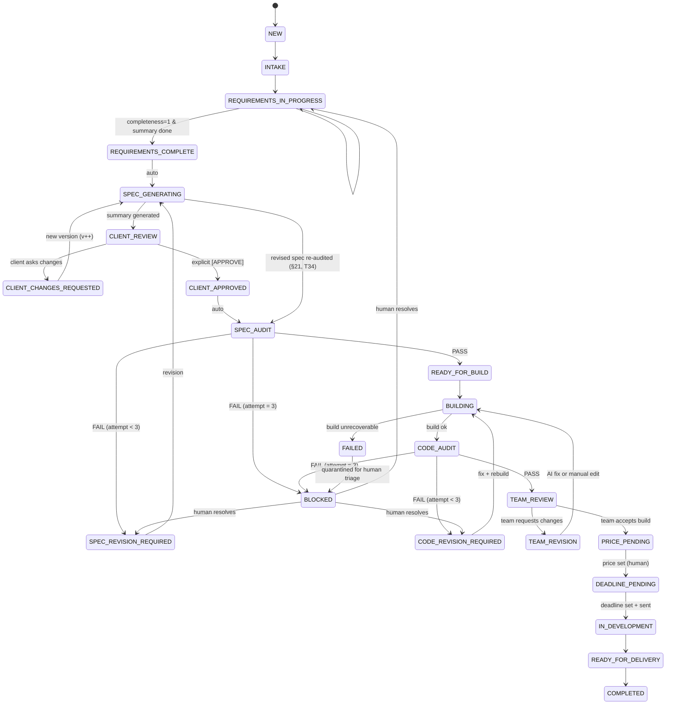

# Deliverable 5 — Project State Machine

**Status:** Phase 0 design. Source: SPEC §3, §4, §21, §26, §42. Decisions: #D-010, #D-011.

## 1. States

Taken verbatim from SPEC §3 (23 states). `BLOCKED` and `FAILED` are *quarantine* states, not progress states.

```
NEW, INTAKE, REQUIREMENTS_IN_PROGRESS, REQUIREMENTS_COMPLETE,
SPEC_GENERATING, CLIENT_REVIEW, CLIENT_CHANGES_REQUESTED, CLIENT_APPROVED,
SPEC_AUDIT, SPEC_REVISION_REQUIRED, READY_FOR_BUILD, BUILDING,
CODE_AUDIT, CODE_REVISION_REQUIRED, TEAM_REVIEW, TEAM_REVISION,
PRICE_PENDING, DEADLINE_PENDING, IN_DEVELOPMENT, READY_FOR_DELIVERY,
COMPLETED, BLOCKED, FAILED
```



## 2. Transition table (authoritative)

`Trigger` = event/actor. `Guard` = condition that must hold. `Effects` = mandatory side effects (all inside the same DB transaction as the state change).

| # | From | To | Trigger | Guard | Effects |
|---|---|---|---|---|---|
| T01 | — | `NEW` | Instagram message creates client+project | no open project for this client/conversation, or client started a new project | `clients.upsert`, `projects.insert`, `events(PROJECT_CREATED)` |
| T02 | `NEW` | `INTAKE` | first inbound message processed | conversation linked | enqueue `REQUIREMENTS_TURN` |
| T03 | `INTAKE` | `REQUIREMENTS_IN_PROGRESS` | Requirements Agent first question sent | website-type detection ran | `project_type` set (may be `UNKNOWN` → asks) |
| T04 | `REQUIREMENTS_IN_PROGRESS` | `REQUIREMENTS_IN_PROGRESS` | each answer turn | — | update fields + status history; contradiction check; enqueue next question or nothing |
| T05 | `REQUIREMENTS_IN_PROGRESS` | `REQUIREMENTS_COMPLETE` | completeness engine reports ready | **all** mandatory fields ∈ {CLIENT_CONFIRMED, CLIENT_APPROVED_DEFAULT, NOT_APPLICABLE} ∧ no open contradictions ∧ no critical ambiguity ∧ internal summary artifact exists | save `requirements vN` + summary artifact; `events(REQUIREMENTS_COMPLETE)` |
| T06 | `REQUIREMENTS_COMPLETE` | `SPEC_GENERATING` | auto (orchestrator) | internal summary present | enqueue `SPEC_GENERATE` |
| T07 | `SPEC_GENERATING` | `CLIENT_REVIEW` | Spec Agent returned SUCCESS | spec version `vN` persisted **and** client summary `vN` generated from it | send summary on channel (or create task if window closed); enqueue `CLIENT_APPROVAL_TIMEOUT` (inactivity) |
| T08 | `CLIENT_REVIEW` | `CLIENT_CHANGES_REQUESTED` | client message classified as change request | message id recorded | extract changed fields; keep `vN` immutable |
| T09 | `CLIENT_CHANGES_REQUESTED` | `SPEC_GENERATING` | auto | change parsed, ≤ `max_client_revision_cycles` | new spec version `vN+1`; new summary; events |
| T10 | `CLIENT_REVIEW` | `CLIENT_APPROVED` | explicit client approval (keyword/quick-reply/parsed intent **with message ref**) | approval message id stored in `client_approvals` | **lock spec vN** (`locked_at`), `client_approvals.insert(APPROVED)`, events |
| T11 | `CLIENT_APPROVED` | `SPEC_AUDIT` | JOB (`SPEC_AUDIT`) | locked spec version exists | the job opens a new audit cycle (`cycle_key` = the approved version) and runs the auditor |
| T12 | `SPEC_AUDIT` | `READY_FOR_BUILD` | Spec Auditor status = PASS (merged verdict, D-035) | audit row persisted with score | `spec_audits.insert`; the audited version is LOCKED (a revision that closed audit gaps becomes the build source, D-038); events + audit report artifact. Enqueueing `BUILD_RUN` is Phase 5's T16 |
| T13 | `SPEC_AUDIT` | `SPEC_REVISION_REQUIRED` | auditor FAIL | attempts of this cycle < `loop.spec_audit.max` (3) | `spec_audits.insert` (the attempt counter IS these rows, D-038); persist the merged findings; enqueue `SPEC_REVISE` with the exact issues |
| T14 | `SPEC_REVISION_REQUIRED` | `SPEC_GENERATING` | JOB (`SPEC_REVISE`) | findings exist | spec agent receives the auditor's issues + previous version |
| **T34** | `SPEC_GENERATING` | `SPEC_AUDIT` | Spec Agent returned SUCCESS for an audit revision | a locked (approved) base exists | enqueue `SPEC_AUDIT` for the revision; **no client message** — the auditor's client-alignment check is what guards the approval already given (§21, added in Phase 4, D-036) |
| T15 | `SPEC_AUDIT` | `BLOCKED` | auditor FAIL | attempts == `loop.spec_audit.max` | create human task `HUMAN_REVIEW` (CRITICAL) whose reason explains WHY a human is needed (§42) and quotes every unresolved issue; **stop automation** (no further pipeline job) |
| T16 | `READY_FOR_BUILD` | `BUILDING` | auto or team "Rebuild" | stack/tech gate approved (`tech_approval` present or config allows auto) | create `builds` row (vN), create workspace, enqueue `BUILD_RUN` |
| T17 | `BUILDING` | `CODE_AUDIT` | coding agent SUCCESS **and** build runner: install+build exit 0 | logs artifact stored | persist build version + artifacts + preview URL; enqueue `CODE_CHECK` |
| T18 | `BUILDING` | `FAILED` | build error non-retryable **or** retries exhausted | — | store structured error (§40); create human task; notify |
| T19 | `CODE_AUDIT` | `TEAM_REVIEW` | checker PASS | `buildSucceeded=true` ∧ no critical security issue ∧ `RUNTIME_TESTED` coverage ≥ configured threshold for testable requirements | persist `code_checks` + findings + evidence; enqueue `TEAM_NOTIFY` |
| T20 | `CODE_AUDIT` | `CODE_REVISION_REQUIRED` | checker FAIL (non-critical) | `loop_counters.code_check.attempts < 3` | increment; structured feedback → coding agent; keep previous build version |
| T21 | `CODE_AUDIT` | `BLOCKED` | checker FAIL | `attempts == 3` **or** critical security issue (immediate) | human task with all failed checks, attempted fixes, current version, attempt log |
| T22 | `CODE_REVISION_REQUIRED` | `BUILDING` | auto | feedback artifact exists | new build version `vN+1` |
| T23 | `TEAM_REVIEW` | `TEAM_REVISION` | team action "Request AI Fix" / "Edit" / "Rebuild" | team member authenticated | task created; if AI fix → enqueue coding agent with team instructions |
| T24 | `TEAM_REVISION` | `BUILDING` | auto | instructions exist | build `vN+1` |
| T25 | `TEAM_REVIEW` | `PRICE_PENDING` | team action "Mark Ready for pricing" | build + check PASS exist | task `PRICE_DECISION` assigned to unassigned/lead |
| T26 | `PRICE_PENDING` | `DEADLINE_PENDING` | human sets final price | price set by **human** (API rejects AI-authored price) | store price audited: `set_by`, `source=HUMAN`; draft message generated, **not sent** |
| T27 | `DEADLINE_PENDING` | `IN_DEVELOPMENT` | human sets deadline **and** approves the message draft & sends it | deadline set by human; message sent confirmation recorded | store deadline; outbound message row; events |
| T28 | `IN_DEVELOPMENT` | `READY_FOR_DELIVERY` | team action | acceptance checklist signed off | task `DELIVERY_PREP` |
| T29 | `READY_FOR_DELIVERY` | `COMPLETED` | team action | delivery record exists (link/handover notes) | freeze project; retention policy applies |
| T30 | any non-terminal | `BLOCKED` | human action "Block" or non-recoverable integration/LLM failure with retries exhausted | reason required | task + notification; records `blocked_from` state |
| T31 | `BLOCKED` | `<blocked_from>` | human action "Resolve" | resolution note required | resume with prior state; reset the relevant loop counter **only if** human explicitly chooses (§21/§26 rules) |
| T32 | `FAILED` | `BLOCKED` | auto after failure notification | — | mandatory human triage |
| T33 | `COMPLETED` | `TEAM_REVISION` *(via Change Request only)* | approved change request | `change_requests.status = APPROVED` | new spec version + new build version; history preserved (§35) |

### 2.1 Disallowed transitions (examples)

- `NEW → BUILDING`, `REQUIREMENTS_* → BUILDING` — build requires a locked approved spec (T16 guard).
- `CLIENT_REVIEW → CLIENT_APPROVED` without a client message reference (§10A, §19).
- Any transition authored by an AI agent to `PRICE_PENDING`/`DEADLINE_PENDING`/`COMPLETED` (§30).
- Re-entry into `SPEC_GENERATING` after lock **without** a Change Request (§35, T33).
- Any transition that would silently drop `loop_counters` (§21, §26).

## 3. Guards — implementation contract

```ts
// packages/core/src/state-machine/transitions.ts  (Phase 1 skeleton, no logic in Phase 0)
export type TransitionId = 'T01' | 'T02' | ... ;
export interface TransitionDef {
  id: TransitionId;
  from: ProjectState[];
  to: ProjectState;
  trigger: TriggerType;                 // 'WEBHOOK' | 'AGENT_SUCCESS' | 'AGENT_FAILURE' | 'HUMAN_ACTION' | 'TIMER' | 'JOB'
  guard: (ctx: GuardContext) => GuardResult;   // pure, unit-testable
  effects: EffectSpec[];                // declarative list, executed in one tx
  actor: 'SYSTEM' | 'AI_AGENT' | 'HUMAN';
  requiresReason?: boolean;
}
```

`GuardContext` = snapshot of project + counters + latest agent runs + entity presence (locked spec, build, check, approval). **Pure functions only** — no IO inside guards → 100% unit-testable (see `14_testing_strategy.md`).

Every transition writes exactly one row to `project_state_transitions`:

```
id, project_id, transition_id, from_state, to_state, actor_type, actor_id,
trigger, reason (nullable, mandatory for BLOCKED/human-forced),
context_json (counters, entity refs), created_at
```

This table is the **single source of truth for history** and powers the Team Panel timeline (§48 Q2, §39).

## 4. Loop counters (anti-infinite-loop)

| Counter | Limit (config key) | Default | On exceed |
|---|---|---|---|
| `spec_audit.attempts` | `loop.spec_audit.max` | 3 | `BLOCKED` + human task (T15) |
| `code_check.attempts` | `loop.code_check.max` | 3 | `BLOCKED` + human task (T21) |
| `client_revision.cycles` | `loop.client_revision.max` | 5 | create human task "client keeps changing scope" (§42) |
| `requirements.questions` | `loop.requirements.max_questions` | 40 | stop asking, mark remaining as `UNCLEAR`, escalate |
| `clarification.cycles` per field | `loop.requirements.max_clarifications_per_field` | 2 | set `UNCLEAR`, surface in spec as open question |
| `agent.invalid_json_repairs` | `loop.agent.max_repairs` | 1 | `NEEDS_REVIEW` (§49) |
| `job.attempts` | `loop.job.max_attempts` | 5 (exp backoff) | dead-letter + alert |
| `inactivity.reminders` | `loop.requirements.inactivity_reminders` | 2 | human task "client silent" |

Counters live in `loop_counters (project_id, scope, key, value, updated_at)` — **persisted, never in-memory** so restarts cannot reset a loop (SPEC §4 "protection against infinite AI loops").

## 5. Who may trigger what

| Actor | Allowed triggers |
|---|---|
| `SYSTEM` (orchestrator) | T06, T07(auto checks), T09, T11, T14, T16(auto), T17, T22, T24, T32 |
| `AI_AGENT` | reports only (`SUCCESS`/`FAILED`/`NEEDS_REVIEW`); **never** performs a transition |
| `HUMAN` | T15-adjacent resolutions, T23, T25, T26, T27, T28, T29, T30, T31, T33 |
| `WEBHOOK` (client message) | T01, T04, T08, T10 |
| `TIMER` | inactivity reminders, SLA escalations |

## 6. State → allowed job types

| State | Jobs that may run |
|---|---|
| `INTAKE`, `REQUIREMENTS_IN_PROGRESS` | `REQUIREMENTS_TURN`, `INACTIVITY_CHECK` |
| `REQUIREMENTS_COMPLETE`, `SPEC_GENERATING`, `SPEC_REVISION_REQUIRED` | `SPEC_GENERATE`, `SPEC_REVISE` (a revision is produced in `SPEC_REVISION_REQUIRED`, §21) |
| `CLIENT_REVIEW`, `CLIENT_CHANGES_REQUESTED` | `CLIENT_INTENT_PARSE`, `CLIENT_APPROVAL_TIMEOUT` |
| `CLIENT_APPROVED` | `CLIENT_INTENT_PARSE`, `SPEC_AUDIT` (T11 is JOB-triggered), `SEND_OUTBOUND` |
| `SPEC_AUDIT` | `SPEC_AUDIT` |
| `READY_FOR_BUILD`, `BUILDING`, `CODE_REVISION_REQUIRED`, `TEAM_REVISION` | `BUILD_RUN` |
| `CODE_AUDIT` | `CODE_CHECK` |
| `TEAM_REVIEW` | `TEAM_ASSISTANT_TASK` (summaries/drafts only) |
| `BLOCKED`, `FAILED`, `COMPLETED` | none (except `ADMIN_*` maintenance jobs) |

A worker claims a job **only if** `project.state` is in the job type's allowed set; otherwise the job is parked with reason `STATE_MISMATCH` (this is the mechanism that makes "next agent invoked only when prerequisites are satisfied" real, §4.6).

## 7. Invariants (asserted in tests + DB constraints where possible)

0. The §21 audit loop cannot exceed its ceiling: attempts are derived from `spec_audits` rows of the cycle (`cycle_key`), so a crash, replay or restart cannot re-open revisions; after the ceiling the project is `BLOCKED` with a human task quoting the unresolved issues and no further `SPEC_AUDIT`/`SPEC_REVISE` job is enqueued.

1. A build cannot exist without a locked spec version it was built from (`builds.spec_version_id NOT NULL`).
2. A `code_check` cannot exist without a build (`code_checks.build_id NOT NULL`, per-requirement rows reference `spec_requirements`).
3. `client_approvals` rows are immutable; a second approval for the same spec version is a no-op (idempotent).
4. `project_state_transitions` is append-only (no UPDATE/DELETE grants).
5. Any `BLOCKED` state has ≥1 open `tasks` row of type `HUMAN_REVIEW`.
6. No state can be left with zero pending jobs and no open task unless it is `COMPLETED`/`FAILED`/`BLOCKED` or a human-gated state (`TEAM_REVIEW`, `PRICE_PENDING`, `DEADLINE_PENDING`, `IN_DEVELOPMENT`, `READY_FOR_DELIVERY`) — this is the "no stranded project" invariant, checked by a watchdog job.
