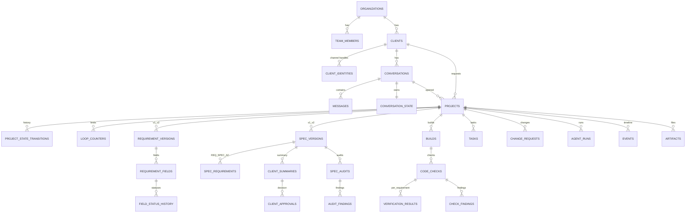

# Deliverable 3 — Database Schema

**Status:** Phase 0 design (DDL-level). Source: SPEC §12, §32–§36, §41. Stack: PostgreSQL 16 + Drizzle ORM; PGlite for dev/CI.

Conventions:
- PKs: `id TEXT PRIMARY KEY` holding **UUIDv7** (sortable, generated in app) — stable across environments, safe to expose internally.
- Timestamps: `timestamptz` in UTC; every important table has `created_at`, mutable ones add `updated_at`.
- JSONB for structured payloads that follow a versioned JSON Schema (`schema_version` column alongside).
- No hard deletes on versioned/history tables; instead status columns + append-only history tables (§34).
- `org_id` exists on all top-level tables (single row today) to make the §2 SaaS migration mechanical.

## 1. Enums

```sql
CREATE TYPE project_state AS ENUM (
  'NEW','INTAKE','REQUIREMENTS_IN_PROGRESS','REQUIREMENTS_COMPLETE',
  'SPEC_GENERATING','CLIENT_REVIEW','CLIENT_CHANGES_REQUESTED','CLIENT_APPROVED',
  'SPEC_AUDIT','SPEC_REVISION_REQUIRED','READY_FOR_BUILD','BUILDING','CODE_AUDIT',
  'CODE_REVISION_REQUIRED','TEAM_REVIEW','TEAM_REVISION','PRICE_PENDING',
  'DEADLINE_PENDING','IN_DEVELOPMENT','READY_FOR_DELIVERY','COMPLETED','BLOCKED','FAILED');

-- SPEC §10A : the ONLY requirement status vocabulary in the system
CREATE TYPE requirement_status AS ENUM (
  'EMPTY','UNCLEAR','AI_INFERRED','DEFAULT_PROPOSED','CLIENT_CONFIRMED',
  'CLIENT_APPROVED_DEFAULT','NOT_APPLICABLE');

CREATE TYPE priority_level   AS ENUM ('MUST','NICE_TO_HAVE','LATER');
CREATE TYPE agent_type       AS ENUM ('REQUIREMENTS','SPECIFICATION','SPEC_AUDITOR','CODING','CODE_CHECKER','TEAM_ASSISTANT');
CREATE TYPE run_status       AS ENUM ('QUEUED','RUNNING','SUCCESS','FAILED','NEEDS_REVIEW','CANCELLED');
CREATE TYPE job_status       AS ENUM ('PENDING','RUNNING','DONE','FAILED','PARKED','DEAD_LETTER');
CREATE TYPE channel_type     AS ENUM ('INSTAGRAM','SIMULATOR','TELEGRAM','WEBCHAT');   -- others reserved (§31)
CREATE TYPE message_direction AS ENUM ('INBOUND','OUTBOUND');
CREATE TYPE message_status   AS ENUM ('RECEIVED','QUEUED','SENT','DELIVERED','READ','FAILED','SEND_BLOCKED');
CREATE TYPE audit_status     AS ENUM ('PASS','FAIL','ERROR');
CREATE TYPE check_status     AS ENUM ('PASS','FAIL','ERROR');
CREATE TYPE verification_method AS ENUM ('RUNTIME_TESTED','STATIC_ONLY','NOT_VERIFIED');
CREATE TYPE severity         AS ENUM ('CRITICAL','MAJOR','MINOR','INFO');
CREATE TYPE task_type        AS ENUM ('HUMAN_REVIEW','PRICE_DECISION','DEADLINE_DECISION','CLIENT_SILENT','SCOPE_CHANGE','MANUAL_SEND','DELIVERY_PREP','OTHER');
CREATE TYPE task_status      AS ENUM ('OPEN','IN_PROGRESS','BLOCKED','DONE','CANCELLED');
CREATE TYPE approval_decision AS ENUM ('APPROVED','CHANGES_REQUESTED','PENDING');
CREATE TYPE change_request_status AS ENUM ('REQUESTED','ANALYZING','APPROVED','REJECTED','IMPLEMENTING','COMPLETED');
CREATE TYPE build_status     AS ENUM ('QUEUED','WORKSPACE_READY','CODING','BUILDING','BUILT','FAILED','ABANDONED');
CREATE TYPE actor_type       AS ENUM ('SYSTEM','AI_AGENT','HUMAN','CLIENT');
CREATE TYPE event_type       AS ENUM ('PROJECT_CREATED','STATE_CHANGED','MESSAGE_INBOUND','MESSAGE_OUTBOUND','MESSAGE_SEND_BLOCKED',
                                      'REQUIREMENTS_COMPLETE','SPEC_GENERATED','SPEC_LOCKED','SPEC_AUDIT_RESULT','BUILD_STARTED','BUILD_FINISHED',
                                      'CODE_CHECK_RESULT','TASK_CREATED','TASK_STATUS_CHANGED','APPROVAL_RECORDED','CHANGE_REQUEST','AGENT_RUN_FINISHED',
                                      'HUMAN_ACTION','SECURITY_ALERT','SYSTEM_ERROR','WEBHOOK_RECEIVED','WEBHOOK_DUPLICATE');
```

## 2. Identity & access

| Table | Key columns | Notes |
|---|---|---|
| `organizations` | `id, name, created_at` | single row now; every top-level table has `org_id` (§2 SaaS path) |
| `team_members` | `id, org_id, email UNIQUE, name, password_hash, role, status, last_login_at, totp_secret_enc` | roles: `ADMIN`,`LEAD`,`MEMBER`,`VIEWER`; no public registration (§2) |
| `sessions` | `id, member_id, token_hash UNIQUE, expires_at, ip, user_agent, revoked_at` | opaque session ids; rotated on privilege change |
| `team_actions` | `id, member_id, action, entity_type, entity_id, payload_json, created_at` | audit log of all human actions (§37) |

## 3. Clients & conversations

```sql
CREATE TABLE clients (
  id TEXT PRIMARY KEY, org_id TEXT NOT NULL REFERENCES organizations(id),
  display_name TEXT, notes TEXT,
  created_at timestamptz NOT NULL DEFAULT now(), updated_at timestamptz NOT NULL DEFAULT now()
);

CREATE TABLE client_identities (             -- one client may have several channel handles
  id TEXT PRIMARY KEY, client_id TEXT NOT NULL REFERENCES clients(id),
  channel channel_type NOT NULL, external_id TEXT NOT NULL,   -- IGSID for Instagram
  username TEXT, display_name TEXT,
  created_at timestamptz NOT NULL DEFAULT now(),
  UNIQUE (channel, external_id)              -- identity resolution key (no mixing clients, §32)
);

CREATE TABLE channel_connections (           -- Instagram page/app credentials per connection
  id TEXT PRIMARY KEY, org_id TEXT NOT NULL, channel channel_type NOT NULL,
  external_account_id TEXT,                  -- IG professional account id
  access_token_enc TEXT, token_expires_at timestamptz, scopes TEXT[],
  status TEXT NOT NULL DEFAULT 'ACTIVE',     -- ACTIVE | NEEDS_REAUTH | DISABLED
  last_verified_at timestamptz, created_at timestamptz NOT NULL DEFAULT now()
);

CREATE TABLE conversations (
  id TEXT PRIMARY KEY, org_id TEXT NOT NULL,
  client_id TEXT NOT NULL REFERENCES clients(id),
  connection_id TEXT NOT NULL REFERENCES channel_connections(id),
  channel channel_type NOT NULL, external_thread_id TEXT,
  status TEXT NOT NULL DEFAULT 'OPEN',       -- OPEN | ARCHIVED | BLOCKED
  last_client_message_at timestamptz,        -- drives the 24h-window warning (§31A)
  last_business_message_at timestamptz,
  window_expires_at timestamptz,             -- computed on inbound message
  created_at timestamptz NOT NULL DEFAULT now(), updated_at timestamptz NOT NULL DEFAULT now(),
  UNIQUE (connection_id, external_thread_id)
);
CREATE INDEX ON conversations (last_client_message_at);   -- window watchdog scan

CREATE TABLE messages (
  id TEXT PRIMARY KEY, conversation_id TEXT NOT NULL REFERENCES conversations(id),
  project_id TEXT REFERENCES projects(id),    -- nullable until project resolution
  direction message_direction NOT NULL,
  status message_status NOT NULL,
  channel_message_id TEXT,                    -- Instagram mid
  client_identity_id TEXT REFERENCES client_identities(id),
  text TEXT, attachments JSONB DEFAULT '[]',  -- [{type,url,sha256}]
  quick_reply_payload TEXT,
  agent_run_id TEXT,                          -- which AI produced it (if any)
  draft BOOLEAN NOT NULL DEFAULT false,       -- team drafts awaiting manual send (§30)
  error_code TEXT, error_detail TEXT,
  sent_at timestamptz, received_at timestamptz,
  created_at timestamptz NOT NULL DEFAULT now(),
  UNIQUE (conversation_id, channel_message_id)  -- idempotency for inbound (§41)
);

CREATE TABLE webhook_events (                 -- raw inbox + dedupe (§41)
  id TEXT PRIMARY KEY, channel channel_type NOT NULL,
  external_event_id TEXT NOT NULL, signature_valid BOOLEAN NOT NULL,
  payload JSONB NOT NULL, received_at timestamptz NOT NULL DEFAULT now(),
  processed_at timestamptz, processing_error TEXT,
  UNIQUE (channel, external_event_id)
);

CREATE TABLE conversation_state (             -- §32 independent per-conversation state
  conversation_id TEXT PRIMARY KEY REFERENCES conversations(id),
  current_question_field TEXT,               -- e.g. 'payments.provider'
  unanswered_fields TEXT[] DEFAULT '{}',
  pending_default_field TEXT,                -- awaiting accept/reject of a proposed default
  ai_context JSONB DEFAULT '{}',             -- rolling summary + open threads (NOT raw history)
  requirements_version INT,
  status TEXT NOT NULL DEFAULT 'ACTIVE',     -- ACTIVE | WAITING_CLIENT | HANDED_OFF | CLOSED
  updated_at timestamptz NOT NULL DEFAULT now()
);
```

## 4. Projects & orchestration

```sql
CREATE TABLE projects (
  id TEXT PRIMARY KEY, org_id TEXT NOT NULL,
  client_id TEXT NOT NULL REFERENCES clients(id),
  conversation_id TEXT REFERENCES conversations(id),
  name TEXT, project_type TEXT,              -- e.g. 'RESTAURANT','LANDING_PAGE','UNKNOWN'
  state project_state NOT NULL DEFAULT 'NEW',
  blocked_from project_state,                -- where to resume after BLOCKED
  assigned_member_id TEXT REFERENCES team_members(id),
  locked_spec_version_id TEXT,               -- set at CLIENT_APPROVED (§19)
  current_requirements_version INT DEFAULT 0,
  current_spec_version INT DEFAULT 0,
  current_build_version INT DEFAULT 0,
  complexity_estimate JSONB,                 -- AI estimate, informational (§30)
  final_price JSONB,                         -- {"amount":..,"currency":..,"set_by":member,"set_at":..} HUMAN ONLY
  final_deadline DATE,                       -- HUMAN ONLY
  delivery_json JSONB,                       -- handover record
  created_at timestamptz NOT NULL DEFAULT now(), updated_at timestamptz NOT NULL DEFAULT now()
);
CREATE INDEX ON projects (state);
CREATE INDEX ON projects (client_id);

CREATE TABLE project_state_transitions (     -- append-only history (§3, §34)
  id TEXT PRIMARY KEY, project_id TEXT NOT NULL REFERENCES projects(id),
  transition_id TEXT NOT NULL, from_state project_state, to_state project_state NOT NULL,
  actor_type actor_type NOT NULL, actor_id TEXT, trigger TEXT NOT NULL,
  reason TEXT, context_json JSONB DEFAULT '{}',
  created_at timestamptz NOT NULL DEFAULT now()
);
CREATE INDEX ON project_state_transitions (project_id, created_at);

CREATE TABLE loop_counters (                 -- §21, §26 anti-infinite-loop, survives restarts
  project_id TEXT NOT NULL REFERENCES projects(id),
  scope TEXT NOT NULL,                       -- 'spec_audit' | 'code_check' | 'client_revision' | 'requirements' | 'agent_repairs'
  key TEXT NOT NULL DEFAULT 'attempts',
  value INT NOT NULL DEFAULT 0,
  updated_at timestamptz NOT NULL DEFAULT now(),
  PRIMARY KEY (project_id, scope, key)
);

CREATE TABLE jobs (                          -- Postgres-backed queue (§4, §41)
  id TEXT PRIMARY KEY, org_id TEXT NOT NULL,
  project_id TEXT REFERENCES projects(id),
  type TEXT NOT NULL,                        -- REQUIREMENTS_TURN | SPEC_GENERATE | SPEC_REVISE | CLIENT_INTENT_PARSE | SPEC_AUDIT | BUILD_RUN | CODE_CHECK | INACTIVITY_CHECK | SEND_OUTBOUND | WATCHDOG | ...
  payload JSONB NOT NULL DEFAULT '{}',
  idempotency_key TEXT,                      -- UNIQUE when not null
  status job_status NOT NULL DEFAULT 'PENDING',
  priority INT NOT NULL DEFAULT 100,
  run_at timestamptz NOT NULL DEFAULT now(),
  attempts INT NOT NULL DEFAULT 0, max_attempts INT NOT NULL DEFAULT 5,
  locked_by TEXT, locked_at timestamptz, lease_expires_at timestamptz,
  last_error TEXT, dead_lettered_at timestamptz,
  created_at timestamptz NOT NULL DEFAULT now(), updated_at timestamptz NOT NULL DEFAULT now()
);
CREATE UNIQUE INDEX jobs_idem_uq ON jobs (idempotency_key) WHERE idempotency_key IS NOT NULL;
CREATE INDEX jobs_claim_ix ON jobs (status, run_at, priority);

CREATE TABLE job_attempts (
  id TEXT PRIMARY KEY, job_id TEXT NOT NULL REFERENCES jobs(id),
  attempt INT NOT NULL, started_at timestamptz NOT NULL DEFAULT now(),
  finished_at timestamptz, status run_status NOT NULL, error_code TEXT, error_detail TEXT,
  duration_ms INT
);

CREATE TABLE idempotency_keys (              -- generic guard for inbound/outbound effects (§41)
  key TEXT PRIMARY KEY, scope TEXT NOT NULL, created_at timestamptz NOT NULL DEFAULT now()
);

CREATE TABLE events (                        -- append-only, feeds Team Panel timeline + §39
  id TEXT PRIMARY KEY, org_id TEXT NOT NULL, project_id TEXT,
  type event_type NOT NULL, actor_type actor_type NOT NULL, actor_id TEXT,
  payload JSONB DEFAULT '{}', severity severity NOT NULL DEFAULT 'INFO',
  created_at timestamptz NOT NULL DEFAULT now()
);
CREATE INDEX ON events (project_id, created_at DESC);
```

## 5. Requirements (Phase 2)

```sql
CREATE TABLE requirement_versions (
  id TEXT PRIMARY KEY, project_id TEXT NOT NULL REFERENCES projects(id),
  version INT NOT NULL, questionnaire_schema_version TEXT NOT NULL,
  completeness NUMERIC(4,3) NOT NULL DEFAULT 0,
  summary_artifact_id TEXT,                  -- internal summary for Spec Agent (§10.4)
  is_current BOOLEAN NOT NULL DEFAULT false,
  created_by_run_id TEXT, created_at timestamptz NOT NULL DEFAULT now(),
  UNIQUE (project_id, version)
);

CREATE TABLE requirement_fields (
  id TEXT PRIMARY KEY,
  requirement_version_id TEXT NOT NULL REFERENCES requirement_versions(id),
  field_path TEXT NOT NULL,                  -- 'payments.provider', 'design.style'
  category TEXT NOT NULL,                    -- one of the 18 mandatory categories (§6)
  value JSONB,
  status requirement_status NOT NULL DEFAULT 'EMPTY',
  priority priority_level NOT NULL DEFAULT 'MUST',
  mandatory BOOLEAN NOT NULL DEFAULT false,
  confidence NUMERIC(4,3),
  source_message_id TEXT REFERENCES messages(id),   -- REQUIRED for CLIENT_CONFIRMED (10A)
  source_run_id TEXT,
  note TEXT,
  updated_at timestamptz NOT NULL DEFAULT now(),
  UNIQUE (requirement_version_id, field_path),
  -- 10A enforcement at DB level:
  CONSTRAINT client_truth_needs_source CHECK (
    status NOT IN ('CLIENT_CONFIRMED','CLIENT_APPROVED_DEFAULT') OR source_message_id IS NOT NULL
  )
);

CREATE TABLE field_status_history (          -- every status change, versioned (§10A)
  id TEXT PRIMARY KEY, field_id TEXT NOT NULL REFERENCES requirement_fields(id),
  from_status requirement_status, to_status requirement_status NOT NULL,
  reason TEXT, message_id TEXT REFERENCES messages(id), agent_run_id TEXT,
  created_at timestamptz NOT NULL DEFAULT now()
);

CREATE TABLE contradictions (
  id TEXT PRIMARY KEY, project_id TEXT NOT NULL REFERENCES projects(id),
  requirement_version_id TEXT NOT NULL REFERENCES requirement_versions(id),
  field_a TEXT NOT NULL, field_b TEXT NOT NULL, description TEXT NOT NULL,
  severity severity NOT NULL DEFAULT 'MAJOR',
  status TEXT NOT NULL DEFAULT 'OPEN',       -- OPEN | CLARIFYING | RESOLVED | ACCEPTED_BY_CLIENT
  resolution_note TEXT, resolved_at timestamptz, created_at timestamptz NOT NULL DEFAULT now()
);

CREATE TABLE questionnaires (                -- §7, §50 : data, not code
  id TEXT PRIMARY KEY, code TEXT UNIQUE NOT NULL,       -- 'GENERAL', 'RESTAURANT', 'ECOMMERCE', ...
  version INT NOT NULL DEFAULT 1, type TEXT NOT NULL,   -- 'GENERAL' | 'PACKAGE'
  applies_to_project_type TEXT,                          -- null for GENERAL
  definition JSONB NOT NULL,                             -- fields, order, conditions, quick replies, weights
  is_active BOOLEAN NOT NULL DEFAULT true,
  created_at timestamptz NOT NULL DEFAULT now()
);
```

## 6. Specifications, approvals, audits (Phase 3–4)

```sql
CREATE TABLE spec_versions (
  id TEXT PRIMARY KEY, project_id TEXT NOT NULL REFERENCES projects(id),
  version INT NOT NULL,
  requirements_version_id TEXT NOT NULL REFERENCES requirement_versions(id),
  content_md_artifact_id TEXT NOT NULL,      -- rendered Technical Specification (§15)
  content_json_artifact_id TEXT NOT NULL,    -- structured spec (sections → fields) for the auditor/checker
  status TEXT NOT NULL DEFAULT 'DRAFT',      -- DRAFT | IN_REVIEW | LOCKED | SUPERSEDED
  generated_by_run_id TEXT,
  locked_at timestamptz, created_at timestamptz NOT NULL DEFAULT now(),
  UNIQUE (project_id, version)
);

CREATE TABLE spec_requirements (             -- traceability §16 : REQ → SPEC-REQ → AC
  id TEXT PRIMARY KEY,                             -- 'SPEC-REQ-001' style code also stored
  code TEXT NOT NULL, project_id TEXT NOT NULL REFERENCES projects(id),
  spec_version_id TEXT NOT NULL REFERENCES spec_versions(id),
  requirement_field_id TEXT REFERENCES requirement_fields(id),   -- origin REQ
  section TEXT NOT NULL, title TEXT NOT NULL, description TEXT NOT NULL,
  acceptance_criteria JSONB NOT NULL DEFAULT '[]',  -- [{code:'AC-001', text:'...', testable:true}]
  priority priority_level NOT NULL DEFAULT 'MUST',
  verification_expectation TEXT,                    -- what the checker must verify (§25)
  UNIQUE (spec_version_id, code)
);

CREATE TABLE client_summaries (
  id TEXT PRIMARY KEY, project_id TEXT NOT NULL REFERENCES projects(id),
  spec_version_id TEXT NOT NULL REFERENCES spec_versions(id),
  content_md_artifact_id TEXT NOT NULL,
  sent_message_id TEXT REFERENCES messages(id),     -- how it reached the client
  status TEXT NOT NULL DEFAULT 'DRAFT',             -- DRAFT | SENT | CHANGES_REQUESTED | APPROVED | SUPERSEDED
  created_at timestamptz NOT NULL DEFAULT now()
);

CREATE TABLE client_approvals (              -- immutable (§19) — one formal approval
  id TEXT PRIMARY KEY, project_id TEXT NOT NULL REFERENCES projects(id),
  spec_version_id TEXT NOT NULL REFERENCES spec_versions(id),
  client_summary_id TEXT NOT NULL REFERENCES client_summaries(id),
  decision approval_decision NOT NULL,
  message_id TEXT NOT NULL REFERENCES messages(id),   -- explicit client message reference (10A)
  parsed_intent JSONB DEFAULT '{}', confidence NUMERIC(4,3),
  recorded_at timestamptz NOT NULL DEFAULT now(),
  UNIQUE (spec_version_id, decision)
);

CREATE TABLE spec_audits (
  id TEXT PRIMARY KEY, project_id TEXT NOT NULL REFERENCES projects(id),
  spec_version_id TEXT NOT NULL REFERENCES spec_versions(id),
  attempt INT NOT NULL DEFAULT 1,
  status audit_status NOT NULL, score NUMERIC(5,2),
  agent_run_id TEXT, result_artifact_id TEXT NOT NULL,   -- full structured JSON (§20)
  summary TEXT, created_at timestamptz NOT NULL DEFAULT now()
);

CREATE TABLE audit_findings (
  id TEXT PRIMARY KEY, audit_id TEXT NOT NULL REFERENCES spec_audits(id),
  kind TEXT NOT NULL,                        -- COMPLETENESS | CONSISTENCY | AMBIGUITY | CODING_READINESS | CLIENT_ALIGNMENT
  severity severity NOT NULL, code TEXT, description TEXT NOT NULL,
  spec_section TEXT, related_spec_requirement_code TEXT,
  suggested_fix TEXT, status TEXT NOT NULL DEFAULT 'OPEN'
);
```

## 7. Builds, checks (Phase 5–6)

```sql
CREATE TABLE builds (
  id TEXT PRIMARY KEY, project_id TEXT NOT NULL REFERENCES projects(id),
  version INT NOT NULL,
  spec_version_id TEXT NOT NULL REFERENCES spec_versions(id),   -- invariant §7.1
  status build_status NOT NULL DEFAULT 'QUEUED',
  workspace_path TEXT, preview_url TEXT,
  coding_agent_run_id TEXT, build_log_artifact_id TEXT,
  build_succeeded BOOLEAN, install_ms INT, build_ms INT,
  error_json JSONB, created_at timestamptz NOT NULL DEFAULT now(), finished_at timestamptz,
  UNIQUE (project_id, version)
);

CREATE TABLE build_logs (
  id TEXT PRIMARY KEY, build_id TEXT NOT NULL REFERENCES builds(id),
  stream TEXT NOT NULL,                      -- stdout | stderr | agent | runner
  seq INT NOT NULL, line TEXT NOT NULL, created_at timestamptz NOT NULL DEFAULT now()
);

CREATE TABLE code_checks (
  id TEXT PRIMARY KEY, project_id TEXT NOT NULL REFERENCES projects(id),
  build_id TEXT NOT NULL REFERENCES builds(id),              -- invariant §7.2
  spec_version_id TEXT NOT NULL REFERENCES spec_versions(id),
  attempt INT NOT NULL DEFAULT 1,
  status check_status NOT NULL,
  build_succeeded BOOLEAN NOT NULL,
  requirements_checked INT, requirements_passed INT, requirements_failed INT,
  verification_counts JSONB NOT NULL DEFAULT '{}',           -- {runtimeTested, staticOnly, notVerified}
  critical_security_issue BOOLEAN NOT NULL DEFAULT false,
  agent_run_id TEXT, result_artifact_id TEXT NOT NULL,
  created_at timestamptz NOT NULL DEFAULT now()
);

CREATE TABLE verification_results (            -- per requirement, how it was verified (§25A)
  id TEXT PRIMARY KEY, code_check_id TEXT NOT NULL REFERENCES code_checks(id),
  spec_requirement_code TEXT NOT NULL,
  result TEXT NOT NULL,                      -- 'PASS' | 'FAIL' | 'PARTIAL'
  method verification_method NOT NULL,
  evidence JSONB DEFAULT '[]',               -- [{kind:'test',name,artifactId}|{kind:'screenshot',...}]
  note TEXT
);

CREATE TABLE check_findings (
  id TEXT PRIMARY KEY, code_check_id TEXT NOT NULL REFERENCES code_checks(id),
  kind TEXT NOT NULL,                        -- MISSING_FEATURE | BROKEN_FLOW | UI | RESPONSIVE | AUTH | DB | INTEGRATION | PAYMENT | SECURITY | ERROR_HANDLING | LOADING | EMPTY_STATE | SEPARATION | RUNTIME
  severity severity NOT NULL, title TEXT NOT NULL, description TEXT,
  spec_requirement_code TEXT, evidence JSONB DEFAULT '[]',
  suggested_fix TEXT, status TEXT NOT NULL DEFAULT 'OPEN',
  fixed_in_build_version INT
);

CREATE TABLE artifacts (
  id TEXT PRIMARY KEY, org_id TEXT NOT NULL, project_id TEXT,
  kind TEXT NOT NULL,                        -- requirement_version | spec_md | spec_json | summary | audit_json | check_json | build_log | screenshot | trace | design_zip | workspace_tar
  path TEXT NOT NULL, sha256 TEXT NOT NULL, size_bytes BIGINT NOT NULL, mime TEXT,
  version INT, created_by_run_id TEXT, created_at timestamptz NOT NULL DEFAULT now()
);
```

## 8. Agents, observability, tasks, changes (cross-phase)

```sql
CREATE TABLE agent_configs (
  id TEXT PRIMARY KEY, org_id TEXT NOT NULL, agent_type agent_type NOT NULL, name TEXT NOT NULL,
  is_active BOOLEAN NOT NULL DEFAULT true, current_version INT NOT NULL DEFAULT 1,
  UNIQUE (org_id, agent_type, name)
);

CREATE TABLE agent_config_versions (          -- §51 versioned prompts/config, rollback-able
  id TEXT PRIMARY KEY, agent_config_id TEXT NOT NULL REFERENCES agent_configs(id),
  version INT NOT NULL, provider TEXT NOT NULL, model TEXT NOT NULL,
  temperature NUMERIC(3,2), max_output_tokens INT, timeout_ms INT,
  max_retries INT NOT NULL DEFAULT 2,
  system_instructions TEXT NOT NULL, output_schema JSONB NOT NULL,
  enabled_tools TEXT[] DEFAULT '{}', notes TEXT,
  created_by_member_id TEXT, created_at timestamptz NOT NULL DEFAULT now(),
  UNIQUE (agent_config_id, version)
);

CREATE TABLE agent_runs (                     -- §36
  id TEXT PRIMARY KEY, project_id TEXT REFERENCES projects(id),
  conversation_id TEXT REFERENCES conversations(id),
  agent_type agent_type NOT NULL, job_id TEXT REFERENCES jobs(id),
  config_version_id TEXT REFERENCES agent_config_versions(id),
  status run_status NOT NULL DEFAULT 'QUEUED',
  input_artifact_id TEXT, output_artifact_id TEXT,
  input_summary JSONB DEFAULT '{}',          -- redacted, no secrets
  started_at timestamptz, finished_at timestamptz, duration_ms INT,
  retry_count INT NOT NULL DEFAULT 0, repair_count INT NOT NULL DEFAULT 0,
  error_code TEXT, error_detail TEXT,
  model TEXT, provider TEXT, prompt_tokens INT, completion_tokens INT, cost_usd NUMERIC(10,4),
  next_action TEXT, confidence NUMERIC(4,3),
  created_at timestamptz NOT NULL DEFAULT now()
);
CREATE INDEX ON agent_runs (project_id, created_at DESC);

CREATE TABLE llm_usage (                      -- cost accounting per project/agent/month
  id TEXT PRIMARY KEY, org_id TEXT NOT NULL, project_id TEXT, agent_run_id TEXT,
  provider TEXT NOT NULL, model TEXT NOT NULL,
  prompt_tokens INT NOT NULL, completion_tokens INT NOT NULL, cost_usd NUMERIC(10,4),
  created_at timestamptz NOT NULL DEFAULT now()
);

CREATE TABLE tasks (                          -- §29
  id TEXT PRIMARY KEY, org_id TEXT NOT NULL, project_id TEXT REFERENCES projects(id),
  type task_type NOT NULL, title TEXT NOT NULL, description TEXT, priority severity NOT NULL DEFAULT 'MAJOR',
  reason TEXT NOT NULL,                       -- WHY a human is needed (§42)
  ai_report JSONB DEFAULT '{}', suggested_action TEXT,
  assignee_member_id TEXT REFERENCES team_members(id),
  status task_status NOT NULL DEFAULT 'OPEN',
  due_at timestamptz, closed_by_member_id TEXT, closed_at timestamptz,
  created_by_agent_run_id TEXT, created_at timestamptz NOT NULL DEFAULT now(), updated_at timestamptz NOT NULL DEFAULT now()
);
CREATE INDEX ON tasks (status, priority);

CREATE TABLE comments (
  id TEXT PRIMARY KEY, project_id TEXT NOT NULL REFERENCES projects(id),
  entity_type TEXT, entity_id TEXT,           -- optional: comment on build/spec/task
  member_id TEXT REFERENCES team_members(id), author_type actor_type NOT NULL DEFAULT 'HUMAN',
  body TEXT NOT NULL, created_at timestamptz NOT NULL DEFAULT now()
);

CREATE TABLE change_requests (                -- §35
  id TEXT PRIMARY KEY, project_id TEXT NOT NULL REFERENCES projects(id),
  requested_by actor_type NOT NULL, source_message_id TEXT REFERENCES messages(id),
  description TEXT NOT NULL, reason TEXT,
  affected_requirement_fields TEXT[] DEFAULT '{}', affected_spec_sections TEXT[] DEFAULT '{}',
  impact_analysis JSONB DEFAULT '{}',          -- effort, risk, price/delivery impact (AI analysis, human-confirmed)
  status change_request_status NOT NULL DEFAULT 'REQUESTED',
  decided_by_member_id TEXT, decided_at timestamptz, decision_note TEXT,
  created_at timestamptz NOT NULL DEFAULT now(), updated_at timestamptz NOT NULL DEFAULT now()
);

CREATE TABLE config_values (                  -- §10 configurable limits, no magic numbers in code
  key TEXT PRIMARY KEY, value JSONB NOT NULL, description TEXT,
  updated_by_member_id TEXT, updated_at timestamptz NOT NULL DEFAULT now()
);
```

## 9. Indexes & constraints summary (beyond PKs/FKs above)

1. `messages (conversation_id, channel_message_id)` UNIQUE — inbound idempotency (§41).
2. `webhook_events (channel, external_event_id)` UNIQUE — duplicate webhook (§41).
3. `jobs_idem_uq` partial unique — duplicate job enqueue (§41).
4. `requirement_fields.client_truth_needs_source` CHECK — §10A enforcement.
5. `builds (project_id, version)` UNIQUE, `spec_versions (project_id, version)` UNIQUE — version chains.
6. `client_approvals (spec_version_id, decision)` UNIQUE — approval idempotency (§19).
7. `projects (state)` partial index for open states — dashboard queries (§28).
8. `events (project_id, created_at DESC)` — timeline (§48).
9. `agent_runs (project_id, created_at DESC)` — observability (§39).
10. `tasks (status, priority)` — task queue for the team (§29).

## 10. ERD (core)



## 11. Migration & seeding policy

- Drizzle-kit generates SQL migrations into `db/migrations/NNNN_*.sql`; forward-only, reviewed in PRs.
- Seed script creates: 1 organization, 1 admin member (password from env), the `GENERAL` questionnaire, 5 website-type packages, default `agent_configs` (disabled until API keys exist), `config_values` defaults.
- Restore drill documented in `15_deployment_strategy.md`.
